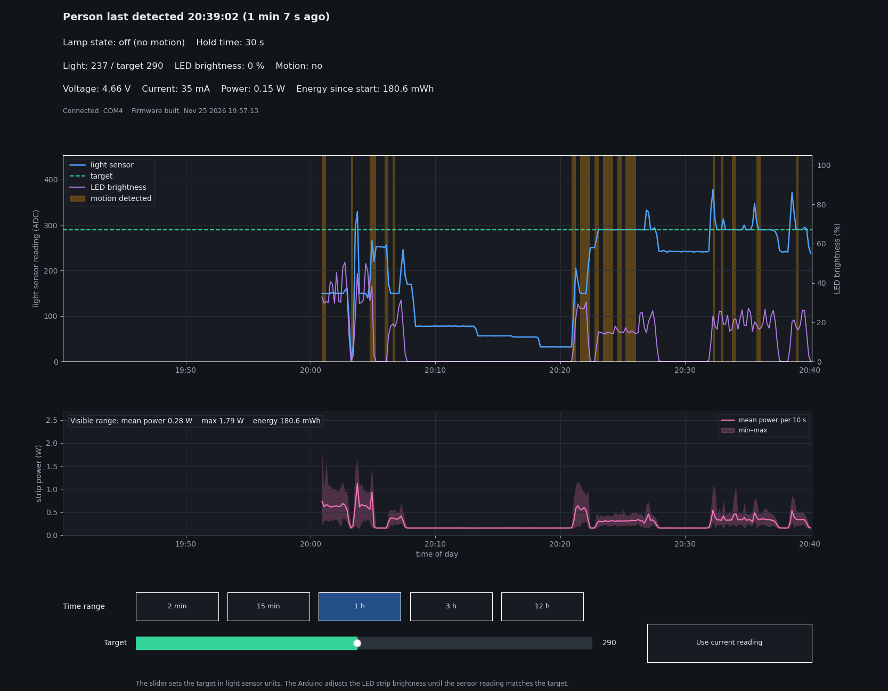

# CPS project: light-sensor-controlled lamp

Final project for the Cyber-Physical Systems course. The lamp (an addressable LED strip) keeps the lighting of a workspace at a target level using a light sensor: the LED strip is the actuator, and a controller changes its brightness until the sensor reading reaches the target. When the motion sensor has not detected anyone for the hold time (default 3 min), the strip turns off with a 30-second animation: the LEDs fade smoothly from the edges towards the centre. When motion is detected again, the light spreads from the centre to the edges and brightens over 30 seconds, after which control resumes. If motion is detected in the middle of turning off, the strip starts brightening from where it was. The animation duration is the constant `LAMP_ANIM_MS` in `lamp_logic.h`. Measurement data is sent over USB to a dashboard on the PC.

## Demo



*The dashboard after about an hour of operation. Top plot: the light sensor reading (blue) is brought to the target (green dashed line) by changing the LED brightness (purple) whenever the motion sensor has detected someone (brown bars). When there has been no motion for the hold time, the strip turns off. Bottom plot: strip power measured with the INA219.*

Videos (Google Drive):

- [Person detected: the light spreads from the centre to the edges](https://drive.google.com/file/d/1BgpEAGG6-np4MgtBc50iXycZL0pA8pQd/view)
- [No person detected: the light fades from the edges to the centre and turns off](https://drive.google.com/file/d/1wSrNJkp_AYtDnmiesoSCmPUTlIBTZIV2/view)
- [The room gets darker: the strip brightens and keeps the light level at the target](https://drive.google.com/file/d/1JN4Tm7w66WcaOYS4BzjhrfnK6mDZBw8F/view)

## Structure

| Folder | Contents |
| --- | --- |
| `firmware/luxlamppu/` | Arduino Uno R3: closed-loop light control, PIR turn-off and wake-up with animations, INA219 current measurement, timing from a Timer1 interrupt, PIR via a pin change interrupt |
| `firmware/luxlamppu/lamp_logic.h` | the lamp logic without hardware: filtering, I controller, state machine, animations |
| `firmware/luxlamppu/test/` | logic test on a PC in a simulated room |
| `firmware/valo_liike_usb/` | early test: only reads the PIR and light sensor and sends the values over USB |
| `firmware/cps_test_led_strip/` | LED strip test: brightness 0–100 % and colour change, data on D6, adjustable current budget |
| `dashboard/` | PC dashboard (Python): motion, light level, LED brightness, voltage, current, power and energy; setting of the light target and hold time |

## Wiring (Arduino Uno R3)

| Part | Wire / pin | Connected to |
| --- | --- | --- |
| Grove PIR Motion Sensor v1.2 | yellow (SIG) | D2 |
| Grove Light Sensor v1.3 | yellow (SIG) | A0 |
| Grove sensors | red (VCC) / black (GND) | 5V / GND |
| LED strip | DIN | 330 Ω -> D6 |
| LED strip | +5V | INA219 VIN− |
| USB breakout (strip power) | VBUS | INA219 VIN+ |
| INA219 | VCC / GND | 5V / GND |
| INA219 | SDA / SCL | A4 / A5 |

The white wire (NC) of the Grove cables is left unconnected. Set the PIR jumper to the Re_trig position. The GND of all parts is connected together (Arduino, USB breakout, LED strip, INA219), but the VBUS of the USB breakout must not be connected to the Arduino 5V pin.

## Usage

1. **Firmware:** install *Adafruit INA219* from the Arduino IDE Library Manager. Open `firmware/luxlamppu/luxlamppu.ino`, set `NUM_LEDS` to the number of LEDs on the strip, select Arduino Uno as the board and the correct port, and press Upload. The light sensor and LED strip use registers directly; the INA219 is read with the library for now.
   **Without the Arduino IDE:** `deploy.ps1` closes a running dashboard, compiles and uploads the firmware with [arduino-cli](https://arduino.github.io/arduino-cli/) (the port is detected automatically) and restarts the dashboard, so the latest dashboard code is also in use:
   ```
   .\deploy.ps1                          # luxlamppu
   .\deploy.ps1 -Sketch cps_blink_colors # another sketch from the firmware folder
   .\deploy.ps1 -NoDashboard             # firmware only
   ```
   Needed once: `scoop install arduino-cli`, `arduino-cli core install arduino:avr` and `arduino-cli lib install "Adafruit INA219"`. The dashboard status line shows the firmware build time, which tells you that the new version is on the board.
2. **Dashboard:**
   ```
   cd dashboard
   pip install -r requirements.txt
   python dashboard.py              # finds the Arduino port automatically
   python dashboard.py --port COM3  # or set the port manually
   python dashboard.py --demo       # test data without an Arduino (3 h of ready-made history)
   python dashboard.py stop         # close a running dashboard from another terminal
   pythonw dashboard.py             # Windows: start without a console window
   python dashboard.py --paivitys 5 # view refresh interval in seconds (default 2; data is still recorded 5 times per second)
   ```
   `stop` sends a command to the running dashboard through the local TCP port 47219 and waits until it has closed. After that the serial port is free, for example for uploading firmware.
   Close the Arduino IDE Serial Monitor before starting the dashboard: the same port cannot be open in two programs. If the port is busy, missing or data stops arriving, the dashboard shows a red notice and reconnects automatically when the port becomes free.

The dashboard has two tabs. **Lamppu** (lamp) shows the light level, target, LED brightness, motion and power. **Järjestelmä** (system) shows the firmware's own timing metrics: CPU load and the maximum delay from tick to work as a function of time (10 min), skipped ticks, PIR latency (when the firmware measures it), telemetry rate, firmware version and INA219 status. The dashboard turns the metrics on with the command `D,1` at the start of every connection. Old firmware does not send them, and the tab says so. The official proof of timing is still `validointi/validoi_ajoitus.py` (see [VALIDOINTI.md](VALIDOINTI.md)).

The slider at the bottom of the dashboard sets the **target in light sensor units** (green dashed line), and the Arduino adjusts the LED strip brightness (purple curve) so that the sensor reading stays at the target. The "Use current reading" button sets the target to the sensor's current reading. The dashboard sends the target and hold time at the start of every connection, and again if the target reported by the Arduino does not match the slider. "100 %" is the highest brightness that the firmware's current budget `CURRENT_LIMIT_MA` allows for white.

The hold time and the controller gain can be given at startup, e.g. `python dashboard.py --pitoaika 20 --ki 3`. A short hold time is handy for testing the animations.

## Timing: Timer1 and interrupt

The firmware does not use the Arduino `millis()` function. The basic unit of time is its own 10 ms tick from Timer1:

- Timer1 is in CTC mode: the counter increments in 4 µs steps and resets when it reaches OCR1A. A compare interrupt is generated at the same time.
- The interrupt service routine `ISR(TIMER1_COMPA_vect)` only increments a `volatile` tick counter. The main loop reads the counter in an `ATOMIC_BLOCK` and runs tasks according to the ticks: control every 10 ticks (100 ms), animation every 2 ticks (20 ms) and telemetry every 20 ticks (200 ms).
- Period: 16 MHz / 64 = 250 kHz → 4 µs per step; 10 ms / 4 µs = 2500 steps → OCR1A = 2499.

| Register | Value | Bits and reason |
| --- | --- | --- |
| TCCR1A | 0x00 | COM1A/B = 00: OC1A/OC1B pins (D9, D10) disconnected from the timer; WGM11:10 = 00 |
| TCCR1B | 0x0B | WGM13:12 = 01 → mode 4 (CTC, TOP = OCR1A); CS12:10 = 011 → prescaler 64 |
| OCR1A | 2499 | compare value: 2500 steps × 4 µs = 10 ms |
| TCNT1 | 0 | counter is cleared before starting |
| TIFR1 | OCF1A = 1 | a stale compare flag is cleared by writing 1 before enabling the interrupt |
| TIMSK1 | 0x02 | OCIE1A = 1: compare interrupt A on |
| SREG | I = 1 | global interrupt enable (set by Arduino `init()`, restored by `timer1_init()`) |

The compiled interrupt service routine is 29 instructions, about 62 clock cycles including response time, i.e. about 4 µs every 10 ms (0.04 % of CPU time). Updating the LED strip disables interrupts for about 1.2 ms. A tick is still not lost: the compare flag stays pending, and the ISR runs right after the update. The main loop reads the counter rather than just a flag, so even a late tick is not lost.

Reusing Timer1 means that `analogWrite` on D9 and D10 does not work. The Arduino Timer0 is left running for now, because the Wire library timeout uses it.

## PIR: pin change interrupt

The PIR is not polled. A change on pin D2 (PD2 = PCINT18) triggers the ISR `ISR(PCINT2_vect)`, which reads the pin level and records only the rising edge, i.e. the start of motion (a `volatile` flag). The main loop reads and clears the flag in an `ATOMIC_BLOCK` and wakes the lamp (`lamp_motion()`) on the next 10 ms tick. With polling, motion was only noticed at the next 100 ms control step.

| Register | Value | Bits and reason |
| --- | --- | --- |
| DDRD | PD2 = 0 | D2 as input |
| PORTD | PD2 = 0 | no internal pull-up: the Grove PIR drives the line itself |
| PCMSK2 | PCINT18 = 1 | only D2 in group 2 (PORTD) triggers the interrupt |
| PCIFR | PCIF2 = 1 | a stale flag is cleared by writing 1 before enabling the group |
| PCICR | PCIE2 = 1 | pin change group 2 on |

A pin change fires on both edges, so the routine checks the pin level. It was chosen over INT0 because only a pin change or INT0's level trigger can wake the MCU from Power-down sleep, and the PIR's idle level is low. The compiled ISR is 20 instructions.

## Energy accounting on the MCU

This is step 1 of the daily energy budget: the lamp will get a daily energy budget for the LED strip and spend it in the hours when someone is usually present and the room is dark. To enforce a budget, the MCU must know how much energy it has used and at what time of day, also when the dashboard is not running.

- `energy_logic.h` integrates the INA219 power into energy in fixed point, with no floating point: power (mW) × time since the previous sample (ms, measured in Timer1 ticks) = energy in µJ, and every 3600 µJ is one µWh. The remainder is carried to the next sample, so small powers are not rounded away.
- The energy is booked into the hour of the day in which it was used (24 × 2 bytes). The Uno has no real-time clock, so the dashboard sends the time of day with `C,<seconds since midnight>` when it connects and every 10 minutes. Between the commands the clock runs on the Timer1 ticks.
- Cost: 88 bytes of SRAM for the `Energy` structure (data use 719 → 809 bytes of 2048) and 1.7 KB of flash (12.9 → 14.6 KB). CPU load in the simulator is unchanged (about 4 %).
- The Järjestelmä tab of the dashboard shows the energy counted by the MCU today and in the current hour, and the MCU clock. The dashboard saves the energy lines to `dashboard/mittaukset/energia_<date>.csv`.

The counters are in SRAM, so they start from zero when the Uno restarts (also when a serial port is opened, because that resets the Uno). Keeping them over a restart in EEPROM is the next step.

## Validation

Every firmware change has a test done on the board and a metric that shows the benefit of the change. They are described in [VALIDOINTI.md](VALIDOINTI.md), and the scripts are in the `validointi/` folder. A PR is merged into the main branch only after the test on the board.

Pin D8 is reserved for a tick marker: it toggles on every Timer1 interrupt (50 Hz). Pin D7 is a motion marker: it goes high when the main loop has handled the rising edge of the PIR, and low when the PIR signal goes low.

## Logic test

The lamp logic (`lamp_logic.h`) can be tested on a PC without an Arduino in a simulated room, where the sensor reading is the background light plus the effect of the LEDs:

```
cd firmware/luxlamppu/test
gcc -std=c99 -Wall -Wextra -I.. test_lamp_logic.c -lm -o test && ./test
gcc -std=c99 -Wall -Wextra -I.. test_energy_logic.c -lm -o test_energy && ./test_energy
```

The test checks that control settles at the target without oscillating for different lamp gains, recovers from an unreachable target (anti-windup), turns the lamp off in a bright room, and that the hold time and animations work at the right times.

The dashboard saves all received data in the folder `dashboard/mittaukset/`, in the file `mittaus_<date>.csv` (`demo_<date>.csv` in demo mode). The folder is created automatically and is not added to Git.

**Time range:** the time range of the plots can be selected with the buttons 2 min, 15 min, 1 h, 3 h or 12 h. At 1 hour and longer, the plots show 10-second averages, and the light area of the power plot shows the minimum and maximum power in each interval. The corner of the power plot shows the mean power, maximum power and energy over the visible range. At startup, the dashboard loads the last 12 hours of measurements from the `mittaus_*.csv` files in `dashboard/mittaukset/`, so the history survives a restart (`--ei-historiaa` skips loading). Gaps in the measurements show as gaps in the curves.

## Message format

The serial port speed is 9600 baud (8N1).

**Arduino → PC**, five times per second: `pir,valo,kirkkaus,tavoite,tila,jannite_mV,virta_mA,teho_mW`, for example `1,150,42,150,1,4987,412,2050`.

- `pir`: 1 when motion is detected, otherwise 0
- `valo`: filtered light sensor ADC reading 0–1023
- `kirkkaus`: mean LED strip brightness in percent (during an animation, the mean over all LEDs)
- `tavoite`: control target in light sensor units
- `tila`: 0 = off, 1 = control, 2 = turn-off animation, 3 = wake-up animation
- `jannite_mV`, `virta_mA`, `teho_mW`: strip supply measured by the INA219; -1 if the INA219 does not respond

**Arduino → PC**, energy accounting (energies in µWh):

- `E,<clock_s>,<synced>,<day_uWh>,<hour_uWh>` every 10 s: MCU time of day, 1 if the clock has been set with `C`, energy since midnight and in the current hour
- `EH,<hour>,<uWh>,<gap_s>` when an hour of the day ends; `gap_s` is the time without a valid INA219 reading
- `ED,<uWh>` when the day ends at midnight
- `#sync,<clock_s before | -1>,<new clock_s>` after each `C` command; the difference shows the clock drift

The dashboard also understands the old formats `pir,valo` and `pir,valo,kirkkaus,jannite_mV,virta_mA,teho_mW`.

**PC → Arduino:**

- `T,<0-1023>`: target in light sensor units
- `H,<1-3600>`: hold time in seconds
- `K,<1-50>`: controller gain (per mille of brightness per ADC unit per 100 ms step)
- `C,<0-86399>`: time of day in seconds since midnight (sent by the dashboard when it connects and every 10 minutes)
- `D,<0|1>`: timing validation line off/on. When on, the Arduino sends once per second the line `#diag,tikit,ohitetut,suurin_viive_us,kuorma_promillea` (ticks, skipped, max delay in µs, load in per mille), which the dashboard shows on the Järjestelmä tab (see [VALIDOINTI.md](VALIDOINTI.md)). The dashboard also understands two extra fields `pir_liikkeet,pir_viive_max_us` (PIR motion count, max PIR latency in µs) when the firmware measures PIR latency.
